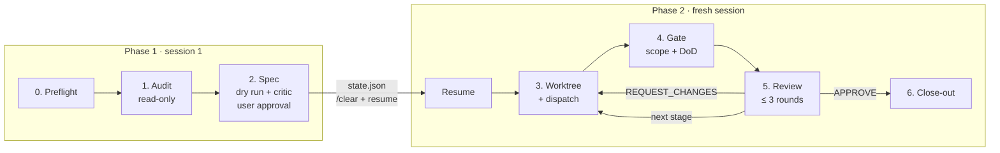

# Spec Audit & Refactor

**English** | [繁體中文](README.zh-TW.md)

[](LICENSE)


An agent skill that turns "audit this codebase and fix what you find" into a
**Lead-Worker workflow**: a Lead agent audits read-only and writes whitelisted specs,
Worker subagents implement them in isolated git worktrees, and every result passes a
scope gate, a Definition-of-Done gate, and a diff review before anything is merged.

## Table of contents

- [Why](#why)
- [Features](#features)
- [How it works](#how-it-works)
- [Requirements](#requirements)
- [Installation](#installation)
- [Usage](#usage)
- [Configuration](#configuration)
- [Scripts](#scripts)
- [Project structure](#project-structure)
- [Testing](#testing)
- [Contributing](#contributing)
- [License](#license)

## Why

Letting one agent both review and edit code makes it easy for "quick fixes" to slip
past review and for changes to sprawl across unrelated files. This skill separates the
roles:

| Role | May | Must not |
| :--- | :--- | :--- |
| **Lead** (reviewer / orchestrator) | Read and search code, run tests and linters, write specs and reviews, manage worktrees | Edit application files — anywhere |
| **Worker** (subagent) | Edit files matched by its whitelist, inside its own worktree, until the DoD passes | Touch non-whitelisted files, commit, push, or leave its worktree |

The main checkout stays untouched: the Lead records a baseline before starting and
verifies it again at close-out.

## Features

- **Read-only audit** producing a gap report with `file:line`, severity, evidence and a
  proposed fix for every finding.
- **Whitelisted specs** with an explicit Definition of Done, plus repo rules pulled from
  `AGENTS.md` / `CLAUDE.md`, so Workers start with the context they need.
- **Isolated git worktrees** per task, with the fork point recorded for exact diffs.
- **Scope gate** (`check_scope.sh`) that rejects any change outside the whitelist —
  committed, staged, unstaged or untracked.
- **Parallel execution**: independent tasks all run at once; related tasks run in
  dependency-ordered stages, each stage built on the integrated result of the previous one.
- **Bounded review loop**: at most three review rounds per task, then escalation to the user.
- **Layout-aware**: works with standard repos and the bare-repo worktree layout, and can
  convert a repo to the bare layout in place (dry run first, automatic rollback on failure).
- **Auto-provisioning**: gitignored `.env` / `.env.*` files are copied and `.venv`
  directories symlinked into new worktrees so tests run there as they do in the source.
- **Multi-runtime**: detects Claude Code, Codex CLI or Antigravity and picks Lead / Worker
  models accordingly.
- **Lean Lead context**: the run is split into two sessions (plan, then execute) with its
  state kept in a persistent run dir, and every test/lint/DoD command runs through
  `run_logged.sh`, so only a one-line summary (plus a tail on failure) reaches the Lead.

## How it works



1. **Preflight** — detect the runtime and worktree layout, check for leftover tasks,
   record a baseline of the Lead's checkout.
2. **Audit** — scan the agreed scope, run existing lint/test/type-check commands, write a
   gap report, and group findings into tasks with small, non-overlapping whitelists.
3. **Spec** — fill a [spec template](references/worker-spec-template.md) per task and an
   [execution plan](references/execution-plan.md) (`independent` or `staged`). Check
   whitelists for overlap, dry-run every DoD command to catch broken or unreachable ones, and
   for larger or riskier plans have a read-only [Plan Critic](references/plan-critic.md)
   challenge the specs. The user gets a decision matrix (scope, risk, shared resources per
   task) ahead of the full specs. **Nothing is dispatched until the user approves.**
   After approval the Lead writes `state.json` to the run dir and ends phase 1: run `/clear`,
   switch to the phase 2 Lead model, and invoke the skill with `resume`. The new session
   checks the baseline and base commit, reads only the plan and the current stage's specs,
   and continues.
4. **Worktree + dispatch** — create one worktree per task on branch `sar/<slug>` and
   dispatch the stage's Workers in parallel (see [dispatch.md](references/dispatch.md)).
5. **Gate** — run `check_scope.sh`, then re-run every DoD command (through
   `run_logged.sh`); all must pass.
6. **Review** — review the diff against the recorded base using the
   [review checklist](references/review-checklist.md). In staged mode, approved tasks are
   committed locally and merged into `sar-stage/<n>` before the next stage starts; between
   stages the user may again continue in a fresh session.
7. **Close-out** — verify the baseline is unchanged, offer PRs, remove worktrees, and
   archive the run dir.
   Pushing, opening PRs and deleting worktrees each require explicit user consent.

The full procedure lives in [SKILL.md](SKILL.md).

## Requirements

- **Bash** and **git ≥ 2.31**
- **python3** (used to read and emit JSON configuration)
- An agent runtime that supports skills and subagents:
  [Claude Code](https://docs.claude.com/en/docs/claude-code), Codex CLI, or Antigravity CLI
- Optional: [GitHub CLI](https://cli.github.com/) (`gh`) for opening PRs at close-out

## Installation

Clone the repository into your agent's skills directory:

```bash
# Shared skills directory
git clone https://github.com/cosmo-chang-1701/spec-audit-and-refactor.git \
  ~/.agents/skills/spec-audit-and-refactor

# Claude Code reads personal skills from ~/.claude/skills
ln -s ~/.agents/skills/spec-audit-and-refactor ~/.claude/skills/spec-audit-and-refactor
```

For a single project, place (or symlink) the directory under that project's skills
directory instead, e.g. `.claude/skills/spec-audit-and-refactor`.

## Usage

Ask your agent in plain language; the skill triggers on requests such as:

```text
Audit src/auth for security issues and fix what you find.
Delegate this refactor to subagents in separate worktrees.
Run a spec-driven Lead-Worker implementation of the plan in docs/plan.md.
Review the worker's branch sar/fix-token-expiry before merging.
```

A typical run pauses twice for your input: once to agree on audit scope, and once to
approve the gap report, specs and execution plan. After that approval the Lead asks you to
start a fresh session and continue with:

```text
/clear
/model sonnet        # the phase 2 Lead model (Claude Code); /effort high
/spec-audit-and-refactor resume
```

Commits, pushes, PRs and worktree removal are always confirmed with you first.

### Default model assignment

| Ecosystem | Lead · phase 1 (audit, spec, critic) | Lead · phase 2 (dispatch, gate, review) | Worker |
| :--- | :--- | :--- | :--- |
| Claude (Claude Code) | `claude-opus-5-5` · high | `claude-sonnet-5-5` · high | `claude-sonnet-5-5` · medium |
| Gemini (Antigravity) | `gemini-3.8-flash-high` · high | same as phase 1 | `gemini-3.8-flash-high` · high |
| Codex | `model` from `~/.codex/config.toml` · high | same as phase 1 | same model · medium |

Override with `SAR_LEAD_MODEL`, `SAR_LEAD_EFFORT`, `SAR_LEAD2_MODEL`, `SAR_LEAD2_EFFORT`,
`SAR_WORKER_MODEL`, `SAR_WORKER_EFFORT`.

## Configuration

No per-repo setup is required — the worktree layout and defaults are detected
automatically:

| | Bare container (`<root>/.bare` + `<root>/main/`) | Standard repo (`.git` in the checkout) |
| :--- | :--- | :--- |
| Task worktree | `<root>/sar/<slug>` | `<parent>/worktrees/<repo>/<slug>` |
| Stage worktree | `<root>/sar-stage/<id>` | `<parent>/worktrees/<repo>/_stage-<id>` |
| Default base | `origin/<default branch>` | `HEAD` |
| Run dir | `<root>/.bare/sar-run/` | `<repo>/.git/sar-run/` |

The run dir (`worktree.sh rundir`) holds the plan, specs, whitelists, logs and `state.json`
of the current run. It sits in the git common dir, so it never shows up as a change, is
shared by all worktrees, and survives a new agent session.

For repos that deviate, add `.agents/spec-audit.json`:

```json
{
  "worktreeRoot": "../wt",
  "pathStyle": "slug",
  "defaultBase": "origin/main",
  "provision": { "copy": [".env.local"], "link": [".venv"], "copyMode": "644" },
  "maxParallel": 4,
  "workerNotes": "Run tests with `make test`, never `pytest` directly.",
  "offerBareLayout": false
}
```

| Environment variable | Effect |
| :--- | :--- |
| `SAR_WORKTREE_ROOT` | Override the worktree root (wins over `worktreeRoot`) |
| `SAR_CONFIG` | Path to a config file to use instead of `.agents/spec-audit.json` |
| `SAR_PROVISION=0` | Disable auto-provisioning of `.env` / `.venv` |
| `SAR_BRANCH_PREFIX` | Task branch prefix (default `sar/`) |
| `SAR_STAGE_PREFIX` | Stage branch prefix (default `sar-stage/`) |
| `SAR_ECOSYSTEM` | Force the runtime ecosystem (`claude`, `gemini`, `codex`) |
| `SAR_LOG_TAIL` | Lines of log `run_logged.sh` prints on failure (default `40`) |

See `scripts/worktree.sh --help` for the full resolution rules.

## Scripts

All scripts can also be used on their own.

| Script | Purpose |
| :--- | :--- |
| [`detect_runtime.sh`](scripts/detect_runtime.sh) | Detect the agent ecosystem and print the phase 1 / phase 2 Lead and Worker models as JSON |
| [`worktree.sh`](scripts/worktree.sh) | Layout-aware worktree lifecycle: `config`, `path`, `create`, `integrate`, `remove`, `list`, `status`, `provision`, `rundir` |
| [`run_logged.sh`](scripts/run_logged.sh) | Run a command with its output in a log file; print a one-line summary (plus the tail on failure) and keep the exit code |
| [`check_scope.sh`](scripts/check_scope.sh) | Fail if any changed file falls outside the whitelist; `--list` / `--overlap` show a whitelist's files and overlaps between whitelists at spec time |
| [`migrate_to_bare.sh`](scripts/migrate_to_bare.sh) | Plan (default) or apply an in-place conversion to the bare-repo worktree layout |
| [`wt.sh`](scripts/wt.sh) | Everyday branch worktrees in the bare layout — for people, not the Lead |

Whitelist format used by `check_scope.sh`:

```text
src/auth/**          # ** spans directories
src/auth/*.ts        # *  stays within one directory
tests/auth/          # trailing / means the whole directory
!src/auth/secrets.ts # leading ! forbids, overriding positive matches
```

## Project structure

```text
.
├── SKILL.md                     # Entry point read by the agent
├── references/
│   ├── bare-layout.md           # Bare-repo layout and the migration prompt
│   ├── dispatch.md              # How to dispatch Workers per runtime
│   ├── execution-plan.md        # Dependency analysis, modes, checkpoint report, run state
│   ├── plan-critic.md           # Read-only adversarial review of the specs
│   ├── review-checklist.md      # Diff review and verdict format
│   └── worker-spec-template.md  # Spec handed to each Worker
├── scripts/                     # Bash helpers (see above)
└── tests/                       # Script tests in throwaway repos
```

## Testing

The tests create throwaway repositories in a temporary directory, ignore your global and
system git config, and clean up on exit:

```bash
bash tests/worktree_test.sh
bash tests/migrate_bare_test.sh
bash tests/check_scope_test.sh
bash tests/run_logged_test.sh
bash tests/detect_runtime_test.sh
```

## Contributing

Issues and pull requests are welcome. Before submitting:

1. Keep scripts in Bash with `set -euo pipefail`, matching the existing style.
2. Add or update tests under `tests/` for any script change, and make sure all test
   suites pass.
3. Keep `SKILL.md` and the files under `references/` in sync with script behaviour.

## License

Released under the [MIT License](LICENSE).
