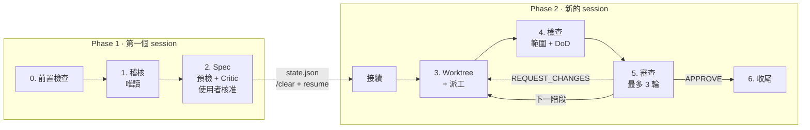

# Spec Audit & Refactor

[English](README.md) | **繁體中文**

[](LICENSE)


一個 agent skill，把「稽核這個 codebase 並修正發現的問題」轉成 **Lead-Worker 工作流程**：
Lead agent 以唯讀方式稽核並撰寫附白名單的 spec，Worker subagent 在各自隔離的 git worktree
中實作，每個結果都必須通過範圍檢查（scope gate）、完成定義檢查（Definition-of-Done gate）
與 diff 審查，才會被合併。

## 目錄

- [為什麼需要它](#為什麼需要它)
- [功能特色](#功能特色)
- [運作方式](#運作方式)
- [系統需求](#系統需求)
- [安裝](#安裝)
- [使用方式](#使用方式)
- [設定](#設定)
- [腳本](#腳本)
- [專案結構](#專案結構)
- [測試](#測試)
- [貢獻](#貢獻)
- [授權條款](#授權條款)

## 為什麼需要它

讓同一個 agent 既審查又修改程式碼，很容易讓「順手修一下」繞過審查，也容易讓變更擴散到不相關
的檔案。這個 skill 將兩種角色分開：

| 角色 | 可以 | 不可以 |
| :--- | :--- | :--- |
| **Lead**（審查者／協調者） | 閱讀與搜尋程式碼、執行測試與 linter、撰寫 spec 與審查意見、管理 worktree | 在任何地方修改應用程式檔案 |
| **Worker**（subagent） | 在自己的 worktree 內修改白名單涵蓋的檔案，直到 DoD 通過 | 修改白名單以外的檔案、commit、push，或離開自己的 worktree |

主要 checkout 全程不會被動到：Lead 開始前會記錄基準狀態，並在收尾時再次驗證。

## 功能特色

- **唯讀稽核**：產出缺口報告（gap report），每項發現都附 `file:line`、嚴重程度、證據與建議修正。
- **附白名單的 spec**：明確的完成定義（Definition of Done），並從 `AGENTS.md` / `CLAUDE.md`
  擷取 repo 規則，讓 Worker 一開始就掌握所需的脈絡。
- **隔離的 git worktree**：每個任務一個 worktree，並記錄分岔點以產生精確的 diff。
- **範圍檢查**（`check_scope.sh`）：任何超出白名單的變更都會被拒絕——無論是已 commit、已 stage、
  未 stage 或未追蹤的檔案。
- **平行執行**：互相獨立的任務同時執行；有關聯的任務依相依順序分階段執行，每個階段都建立在前一
  階段整合後的結果之上。
- **有上限的審查迴圈**：每個任務最多三輪審查，超過則交由使用者決定。
- **感知 worktree 佈局**：支援一般 repo 與 bare-repo worktree 佈局，並可就地將 repo 轉換為
  bare 佈局（先 dry run，失敗時自動 rollback）。Agent 設定（`.claude/`、`AGENTS.md` 等）會在
  容器根目錄建立 symlink，在根目錄啟動 agent CLI 時仍能載入專案的 skill。
- **自動配置環境**：新的 worktree 會自動複製被 gitignore 的 `.env` / `.env.*` 檔案，並以
  symlink 連結 `.venv` 目錄，讓測試能像在原始 checkout 中一樣執行。
- **支援多種執行環境**：自動偵測 Claude Code、Codex CLI 或 Antigravity，並據此選擇 Lead /
  Worker 模型。
- **精簡 Lead 的 context**：較大的流程分成兩個 session（先規劃、再執行），狀態保存在持久的 run dir
  （單一 L/M 風險任務預設留在同一個 session）；
  所有 test / lint / DoD 指令都透過 `run_logged.sh` 執行，Lead 只會看到一行摘要（失敗時附上最後幾行）。

## 運作方式



1. **前置檢查**：偵測執行環境與 worktree 佈局、檢查先前遺留的任務、記錄 Lead checkout 的基準狀態。
2. **稽核**：掃描議定的範圍，執行既有的 lint / test / type-check 指令，撰寫缺口報告，並將發現
   分組為白名單小且互不重疊的任務。
3. **Spec**：為每個任務填寫 [spec 範本](references/worker-spec-template.md)，並擬定
   [執行計畫](references/execution-plan.md)（`independent` 或 `staged`）。接著檢查白名單是否
   重疊、預先執行每條 DoD 指令以找出無效或無法達成的指令；任務較多或風險較高時，再由唯讀的
   [Plan Critic](references/plan-critic.md) 挑戰 spec。呈報時先給使用者決策矩陣（各任務的範圍、
   風險與共用資源），再附完整 spec。**使用者核准前不會派出任何 Worker。**
   核准後，Lead 把 `state.json` 寫入 run dir 並結束 phase 1：執行 `/clear`、切換到 phase 2 的
   Lead 模型，再以 `resume` 呼叫本 skill。新的 session 會先核對基準狀態與 base commit，只讀取
   執行計畫與當前階段的 spec，然後接續執行。小型流程（單一任務、風險 L 或 M）則不換 session，
   直接以 phase 1 的 Lead 模型繼續；可設定 `SAR_SESSION_SPLIT=always|never`，或在核准時說明來改變。
4. **Worktree + 派工**：為每個任務在 `sar/<slug>` 分支上建立 worktree，並平行派出該階段的
   Worker（詳見 [dispatch.md](references/dispatch.md)）。
5. **檢查**：執行 `check_scope.sh`，再透過 `run_logged.sh` 重新執行所有 DoD 指令，全部都必須通過。
6. **審查**：依照[審查清單](references/review-checklist.md)，對照記錄的基準審查 diff。
   在 staged 模式下，核准的任務會先在本機 commit 並合併到 `sar-stage/<n>`，才進入下一階段；
   階段之間也可以再換到新的 session 繼續。
7. **收尾**：確認基準狀態未變、提供建立 PR 的選項、移除 worktree，並封存 run dir。
   push、開 PR 與刪除 worktree 都需要使用者明確同意。

完整流程請見 [SKILL.md](SKILL.md)。

## 系統需求

- **Bash** 與 **git ≥ 2.31**
- **python3**（用於讀取與輸出 JSON 設定）
- 支援 skill 與 subagent 的 agent 執行環境：
  [Claude Code](https://docs.claude.com/en/docs/claude-code)、Codex CLI 或 Antigravity CLI
- 選用：[GitHub CLI](https://cli.github.com/)（`gh`），用於收尾時開 PR

## 安裝

將 repository clone 到 agent 的 skills 目錄：

```bash
# 共用 skills 目錄
git clone https://github.com/cosmo-chang-1701/spec-audit-and-refactor.git \
  ~/.agents/skills/spec-audit-and-refactor

# Claude Code 從 ~/.claude/skills 讀取個人 skills
ln -s ~/.agents/skills/spec-audit-and-refactor ~/.claude/skills/spec-audit-and-refactor
```

若只想用於單一專案，請將目錄放在（或 symlink 到）該專案的 skills 目錄下，例如
`.claude/skills/spec-audit-and-refactor`。

## 使用方式

直接用自然語言告訴 agent 即可，例如以下請求都會觸發這個 skill：

```text
稽核 src/auth 的安全性問題，並修正發現的問題。
把這次重構交給 subagent，在各自的 worktree 中進行。
用 spec-driven 的 Lead-Worker 流程實作 docs/plan.md 的計畫。
合併前先審查 worker 的分支 sar/fix-token-expiry。
```

一般流程會停下來等你兩次：一次是議定稽核範圍，一次是核准缺口報告、spec 與執行計畫。
核准之後，單一 L/M 風險任務會直接在同一個 session 繼續；規模更大時，Lead 會請你開一個新的
session 接續：

```text
/clear
/model sonnet        # phase 2 的 Lead 模型（Claude Code）；/effort high
/spec-audit-and-refactor resume
```

commit、push、開 PR 與移除 worktree 一律會先徵求你的同意。

### 預設模型分配

| 生態系 | Lead · phase 1（稽核、spec、Critic） | Lead · phase 2（派工、檢查、審查） | Worker |
| :--- | :--- | :--- | :--- |
| Claude（Claude Code） | `claude-opus-5-5` · high | `claude-sonnet-5-5` · high | `claude-sonnet-5-5` · medium |
| Gemini（Antigravity） | `gemini-4-argon-high` · high | `gemini-3.8-flash-high` · high | `gemini-3.8-flash-high` · high |
| Codex | `~/.codex/config.toml` 中的 `model` · high | 與 phase 1 相同 | 同一模型 · medium |

可用 `SAR_LEAD_MODEL`、`SAR_LEAD_EFFORT`、`SAR_LEAD2_MODEL`、`SAR_LEAD2_EFFORT`、
`SAR_WORKER_MODEL`、`SAR_WORKER_EFFORT` 覆寫。

## 設定

不需要針對個別 repo 做任何設定，worktree 佈局與預設值都會自動偵測：

| | Bare 容器（`<root>/.bare` + `<root>/main/`） | 一般 repo（checkout 內有 `.git`） |
| :--- | :--- | :--- |
| 任務 worktree | `<root>/sar/<slug>` | `<parent>/worktrees/<repo>/<slug>` |
| 階段 worktree | `<root>/sar-stage/<id>` | `<parent>/worktrees/<repo>/_stage-<id>` |
| 預設 base | `origin/<default branch>` | `HEAD` |
| Run dir | `<root>/.bare/sar-run/` | `<repo>/.git/sar-run/` |

Run dir（`worktree.sh rundir`）存放本次執行的計畫、spec、白名單、log 與 `state.json`。它位於
git common dir 內，所以永遠不會被當成變更、所有 worktree 共用，換了新的 agent session 也還在。

若 repo 有特殊需求，可新增 `.agents/spec-audit.json`：

```json
{
  "worktreeRoot": "../wt",
  "pathStyle": "slug",
  "defaultBase": "origin/main",
  "provision": { "copy": [".env.local"], "link": [".venv"], "copyMode": "644" },
  "maxParallel": 4,
  "workerNotes": "Run tests with `make test`, never `pytest` directly.",
  "offerBareLayout": false
}
```

| 環境變數 | 作用 |
| :--- | :--- |
| `SAR_WORKTREE_ROOT` | 覆寫 worktree 根目錄（優先於 `worktreeRoot`） |
| `SAR_CONFIG` | 指定設定檔路徑，取代 `.agents/spec-audit.json` |
| `SAR_PROVISION=0` | 停用 `.env` / `.venv` 的自動配置 |
| `SAR_BRANCH_PREFIX` | 任務分支前綴（預設 `sar/`） |
| `SAR_STAGE_PREFIX` | 階段分支前綴（預設 `sar-stage/`） |
| `SAR_ECOSYSTEM` | 強制指定執行環境生態系（`claude`、`gemini`、`codex`） |
| `SAR_SESSION_SPLIT` | phase 2 是否換新 session：`auto`（預設；僅多任務或 H 風險時）、`always`、`never` |
| `SAR_LOG_TAIL` | `run_logged.sh` 失敗時印出的 log 行數（預設 `40`） |

完整的解析規則請執行 `scripts/worktree.sh --help`。

## 腳本

所有腳本也都能單獨使用。

| 腳本 | 用途 |
| :--- | :--- |
| [`detect_runtime.sh`](scripts/detect_runtime.sh) | 偵測 agent 生態系，並以 JSON 輸出 phase 1 / phase 2 的 Lead 與 Worker 模型 |
| [`worktree.sh`](scripts/worktree.sh) | 感知佈局的 worktree 生命週期管理：`config`、`path`、`create`、`integrate`、`remove`、`list`、`status`、`provision`、`rundir` |
| [`run_logged.sh`](scripts/run_logged.sh) | 執行指令並把輸出寫入 log 檔；只印一行摘要（失敗時附最後幾行），並保留原本的 exit code |
| [`check_scope.sh`](scripts/check_scope.sh) | 有任何變更檔案超出白名單時回傳失敗；`--list` / `--overlap` 可在撰寫 spec 時列出白名單涵蓋的檔案與白名單之間的重疊 |
| [`migrate_to_bare.sh`](scripts/migrate_to_bare.sh) | 規劃（預設）或執行就地轉換為 bare-repo worktree 佈局 |
| [`wt.sh`](scripts/wt.sh) | 在 bare 佈局中管理日常分支 worktree——供人使用，而非 Lead；`link-config` 重新同步容器根目錄的 agent 設定 symlink |

`check_scope.sh` 使用的白名單格式：

```text
src/auth/**          # ** 可跨越多層目錄
src/auth/*.ts        # *  只在單一目錄內比對
tests/auth/          # 結尾的 / 代表整個目錄
!src/auth/secrets.ts # 開頭的 ! 表示禁止，優先於正向比對
```

## 專案結構

```text
.
├── SKILL.md                     # agent 讀取的進入點
├── references/
│   ├── bare-layout.md           # bare-repo 佈局與轉換提問的格式
│   ├── dispatch.md              # 各執行環境的 Worker 派工方式
│   ├── execution-plan.md        # 相依性分析、執行模式、checkpoint 呈報格式與執行狀態
│   ├── plan-critic.md           # 對 spec 的唯讀對抗式審查
│   ├── review-checklist.md      # diff 審查與判定格式
│   └── worker-spec-template.md  # 交給每個 Worker 的 spec 範本
├── scripts/                     # Bash 輔助腳本（見上方）
└── tests/                       # 在拋棄式 repo 中執行的腳本測試
```

## 測試

測試會在暫存目錄中建立拋棄式 repository，不讀取你的全域與系統 git 設定，並在結束時自動清理：

```bash
bash tests/worktree_test.sh
bash tests/migrate_bare_test.sh
bash tests/check_scope_test.sh
bash tests/run_logged_test.sh
bash tests/detect_runtime_test.sh
```

## 貢獻

歡迎提交 issue 與 pull request。提交前請注意：

1. 腳本維持使用 Bash 並加上 `set -euo pipefail`，與現有風格一致。
2. 修改任何腳本時，請在 `tests/` 新增或更新測試，並確認所有測試都通過。
3. 讓 `SKILL.md` 與 `references/` 下的檔案和腳本行為保持一致。

## 授權條款

本專案採用 [MIT License](LICENSE) 授權。
